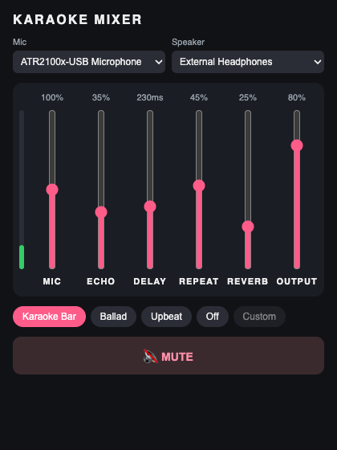

# Karaoke Mic

[](https://github.com/thinhkhang97/karaoke-mic/actions/workflows/ci.yml)

A tiny desktop mixer that plays your microphone through your speaker with a karaoke-bar echo. Open it, plug in the mic, sing.

<p align="center">
  
</p>

## Why it exists

I wanted to sing karaoke at home with what I already had: a wired USB microphone (Audio-Technica ATR2100x-USB), a MacBook and a JBL speaker. Music came from YouTube in the browser.

The problem was getting my voice out of the speaker, with echo, without a delay that throws you off the beat:

- **A Bluetooth speaker lags by 200–300 ms.** You hear your own voice come back late, and it is almost impossible to sing in time. A 3.5 mm AUX cable fixes the lag.
- **macOS has no built-in "hear my mic" switch.** The only way I found was GarageBand. It works, but it is heavy to open and takes several clicks every time, just to hear your voice with some echo.

Karaoke Mic does that one thing. It is about 4 MB, starts playing your voice the moment it opens, and its echo is tuned to sound like a Vietnamese karaoke bar: a clear "you… you… you…" that fades out over a few repeats, plus a little reverb.

## Features

- **Voice out of the speaker on launch.** There is no start button. It picks your USB mic automatically and remembers the devices you chose last time.
- **Six mixer faders:**

  | Fader  | What it does                                | Range     |
  |--------|---------------------------------------------|-----------|
  | MIC    | Input gain of your voice                    | 0–200 %   |
  | ECHO   | Level of the echo                           | 0–100 %   |
  | DELAY  | Time between echo repeats                   | 60–500 ms |
  | REPEAT | How many repeats before the echo fades      | 0–85 %    |
  | REVERB | Room reverb                                 | 0–100 %   |
  | OUTPUT | Final volume                                | 0–100 %   |

- **One-tap presets:** Karaoke Bar, Ballad, Upbeat and Off. Presets change only the echo and reverb, so they never touch your MIC or OUTPUT levels.
- **Big MUTE button** for when the speaker starts howling.
- **Hot-plug:** unplug the mic mid-song and it falls back to another input. Plug it back in and it switches back on its own.
- **Low latency:** the app adds roughly 10–15 ms on a wired output. A soft limiter keeps loud singing from clipping.
- **Bluetooth warning:** if you pick a Bluetooth speaker, the app reminds you that it will lag.

## Use it

> Requires a Mac with Apple Silicon (M1 or newer). Intel Macs, Windows and Linux are on the [roadmap](#roadmap).

1. Download `Karaoke.Mic_0.1.0_aarch64.dmg` from the [latest release](https://github.com/thinhkhang97/karaoke-mic/releases/latest).
2. Open the `.dmg` and drag **Karaoke Mic** into **Applications**.
3. Open the app. The build is not signed with an Apple Developer ID yet, so macOS will block the first launch. To allow it, do either of these:
   - Open **System Settings → Privacy & Security**, scroll down and click **Open Anyway** next to the Karaoke Mic message.
   - Or run this once in Terminal:
     ```bash
     xattr -dr com.apple.quarantine "/Applications/Karaoke Mic.app"
     ```
4. When macOS asks for microphone access, click **Allow**.
5. Plug in your mic, connect your speaker (an AUX cable is best), play a karaoke track on YouTube, and sing.

**Tips**

- Keep the mic pointed away from the speaker. The back of a cardioid mic picks up the least sound.
- If you get feedback (howling), hit **MUTE**, then lower OUTPUT or MIC.

## Build from source

**Prerequisites**

- macOS with the Xcode Command Line Tools: `xcode-select --install`
- [Rust](https://rustup.rs) (stable)
- Node.js 22+ and [pnpm](https://pnpm.io)

**Run in development**

```bash
git clone https://github.com/thinhkhang97/karaoke-mic.git
cd karaoke-mic
pnpm install
pnpm tauri dev
```

**Build the app and installer**

```bash
pnpm tauri build
```

The output lands in `src-tauri/target/release/bundle/`, as `macos/Karaoke Mic.app` and `dmg/Karaoke Mic_<version>_aarch64.dmg`.

**Tests**

```bash
pnpm test                                    # UI state, presets, settings, mixer UI
pnpm test -- --coverage
cd src-tauri && cargo test --lib             # echo, reverb, limiter, resampler, device choice
cd src-tauri && cargo test --lib -- --ignored --nocapture   # smoke test on your real audio devices (output muted)
```

### How it works

```
mic ─▶ cpal input stream ─▶ lock-free ring buffer ─▶ drift-correcting resampler
                                                          │
speaker ◀─ cpal output stream ◀─ soft limiter ◀─ gain ◀─ dry + echo + reverb
```

- **Built with:** [Tauri 2](https://tauri.app). The UI is plain TypeScript. The audio engine is Rust on [cpal](https://github.com/RustAudio/cpal) (CoreAudio on macOS).
- **Echo:** a feedback delay line with a low-pass filter inside the loop, so each repeat sounds a little darker, like a bar mixer's echo. Delay changes are smoothed, so moving DELAY never clicks.
- **Reverb:** a mono Freeverb.
- **Mic and speaker clocks:** the mic and speaker can run at different sample rates (for example, 48 kHz in and 44.1 kHz out). A small resampler keeps the queue between them near 10 ms. It drops any backlog left after a stall and grows the queue if a device uses large buffers.
- **Talking to the audio thread:** fader values reach the audio thread through atomics. The audio callbacks never allocate memory or take locks.

Design notes live in [`docs/superpowers/specs`](docs/superpowers/specs).

## Roadmap

**Windows and Linux**

The audio engine is already cross-platform: cpal uses WASAPI on Windows and ALSA (with PulseAudio and PipeWire through it) on Linux, and the macOS-only pieces sit behind `cfg(target_os = "macos")`. What is left:

- [ ] GitHub Actions to build `.msi`/`.exe` (Windows), `.AppImage`/`.deb` (Linux) and a universal macOS build (Intel and Apple Silicon)
- [ ] Test on real Windows and Linux machines with USB mics, and tune the buffer sizes for WASAPI and ALSA
- [ ] Bluetooth output detection on Windows and Linux (macOS only today)
- [ ] Microphone permission handling on Windows (Settings → Privacy → Microphone)

**Polish**

- [ ] Sign and notarize the macOS build, so it opens without the Gatekeeper workaround
- [ ] Smooth the MIC, ECHO, REVERB and OUTPUT gains, to remove faint zipper noise while dragging
- [ ] Fade out instead of cutting to silence when audio briefly runs dry
- [ ] Back off retries when a device fails to open
- [ ] Use the stronger channel for a stereo mic that carries the signal on one channel only

Ideas and pull requests are welcome. Please open an issue first for anything big. Every pull request runs the frontend and Rust test suites in CI, and both must pass before merging into `main`.

## License

[MIT](LICENSE) © 2026 Khang Nguyễn
